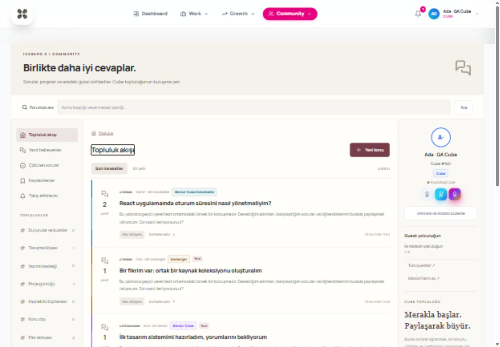

# Cube Forum UI V3

UI V3 keeps the conversation layout from `forum/real-api` (`2ec7373`) and connects it to portal identity and persistent forum preferences. The branch was created from the fork's `main`; source work is only on `umrtkyrk/iceberg-x-os:ui-v3`. No upstream push, PR, sync or deployment is part of this work.

## Local setup

Use a local PostgreSQL database and the portal's usual local authentication setup. Never use production credentials for previews or tests.

```sh
npm ci --prefix backend
npm ci --prefix frontend
cd backend
npx prisma generate
npx prisma migrate deploy
```

Set `FORUM_ENABLED=true` in the local backend environment and `VITE_CUBE_FORUM_ENABLED=true` in the local frontend environment, then start both applications with their usual dev scripts and visit `/forum`. Both flags default to false. The retained legacy `VITE_CUBE_FORUM_PREVIEW` flag also reveals the route; UI V3 always uses the real API and does not fall back to local demo storage. Never commit local environment files.

The historical portal migration ordering issue is unchanged: a clean database may encounter the pre-existing Quest ordering problem. The isolated database test builds a portal baseline in its own random test schema and applies both forum SQL migrations over that baseline; this verifies the forum additions, not the historical migration chain. Existing migrations are not edited.

## Behaviour

- Avatar, Cube number, candidacy, progression, Founding Cube and account role come from portal records. They cannot be changed through forum preferences. Senior Cube and Iceberger do not gain moderation privileges.
- Author cards show up to three selected **earned** badges, with Common/Rare/Epic/Legendary presentation, in the selected order. Revoked awards stop displaying. A plain-text signature of at most 140 characters appears below every author's post, across devices.
- Signature and ordered badge IDs persist in `ForumProfile`. The server rejects foreign, duplicate and fourth badges; zero badges are valid. The forum selects only public author fields, never a raw profile, NDA details, contact data, scorecard or private feedback.
- Cubes, candidates, Senior Cubes and Icebergers may post. Mentors/Admins may post without a Cube profile. Alumni, Former Cubes and accounts without the required Cube profile can read; they cannot create/edit topics or replies. Owners can still withdraw their content and manage saved/followed topics and preferences.
- Only Mentor/Admin can create topics in a staff-only category. The built-in announcements category always remains staff-only. Only Admin can create/edit/delete categories; a category containing any topic, including deleted history, cannot be removed. Mentor/Admin can move, pin, lock and remove topics and review reports, but cannot rewrite another author's words.
- Quest and mission selectors use real accessible portal records. A Cube can attach only an assigned quest or a mission they currently contribute to. Staff see a catalogue, without fabricated personal progress. Tags do not complete quests or issue rewards. Topics can be filtered by quest or mission.
- The six existing real-api categories are retained. `Fikir atölyesi` is added with a new ID if absent; no category IDs or existing topics are renamed. Admin can adjust labels/order or consolidate through topic moves.
- The portal's existing bell and history link to the exact forum reply. The server resolves the current reply page, so deleted earlier replies do not leave a stale page number. Opening the notification focuses the target post. Removed content no longer has a clickable notification target.
- Reply recipients combine the owner, followers and mentions, excluding the writer and exited Cubes. One notification per event/person is created even when these sets overlap. Handles are `@cube-018` or, for staff without Cube profiles, `@user-<user-id>`. The composer offers a name search to insert these handles. Unknown handles are ignored; the first ten distinct valid handles are considered. Code and block quotations do not produce mentions. Edits do not resend notifications.
- A topic's edited marker is stored separately from last activity, so a reply, pin or move does not mark the topic as edited. Replies remain chronological with stable tie-breaking and pagination. Topic reads and writes share the topic lock to protect unread state.
- The inherited accepted-answer feature remains available; it was already in real-api and is outside the attached mission's minimum scope. No reactions, reputation/XP or new Radar/MVCubes scoring is introduced.

## Additive data changes

Apply `20261028120000_add_forum` from real-api, then `20261029120000_forum_portal_integration`.

The new migration creates only `ForumProfile`, `ForumTopicContext` and `ForumNotificationTarget`, their foreign keys/indexes, and the optional missing ideas category. Existing portal columns and data are unchanged. `ForumTopicContext` owns the optional Quest/Mission links and topic edit timestamp. Notification targets extend the existing message-only notification flow without altering `Notification` columns.

## Added API

| Method | Route | Access |
| --- | --- | --- |
| GET / PUT | `/api/forum/me/profile` | Own identity/preferences; writes validate earned badges |
| GET | `/api/forum/context` | Role-specific quest/mission options |
| GET | `/api/forum/mentions?q=...` | Up to ten public names and stable handles |
| POST | `/api/forum/categories` | Admin |
| PATCH / DELETE | `/api/forum/categories/:id` | Admin; deletion requires no topic history |
| PATCH | `/api/forum/topics/:id/moderation` | Mentor/Admin; now also supports `category_id` |

Topic creation/edit accepts nullable `quest_id`/`mission_id`; topic lists accept `quest`/`mission` filters. Topic detail accepts `reply` and returns the resolved `page`. Notifications add a nullable internal `link`. Existing topics/replies/state/report endpoints are retained. All forum API routes remain behind the backend feature flag and authentication; write operations retain the per-user 20/minute limit from real-api (per process).

## Validation and limitations

```sh
npm run build --prefix backend
npm test --prefix backend
npm run test:forum --prefix backend
npm run test:forum:flag --prefix backend
npm run check:forum --prefix frontend
npm run test:forum --prefix frontend
npm run build --prefix frontend
```

For real PostgreSQL integration, point `DATABASE_URL` at a disposable **localhost** database and run `npm run test:forum:db --prefix backend`. This creates/drops only a random `forum_test_*` schema. It covers both additive migrations, persistent preferences, badge ownership, quest access, no quest reward side effects, deduplicated mentions/targets, reply-page resolution, moderation, reports and account deletion.

Verified on 29 October 2026 with a separate temporary PostgreSQL 18 instance and synthetic Cube/Admin accounts: category creation, topic move, preference saving across reload, mention delivery, click-to-reply focus and 390px/1440px layouts. Screenshots contain QA fixtures only. Frontend builds retain the portal's existing large-bundle warning.

No new production dependency, live deployment, production migration or upstream operation was performed. The inherited rate limiter remains in memory per process; multi-instance limits and historical migration-chain repair are separate work.

## Screenshots (synthetic local test data)



[Mobile topic view](forum-ui-v3-mobile.jpg)
