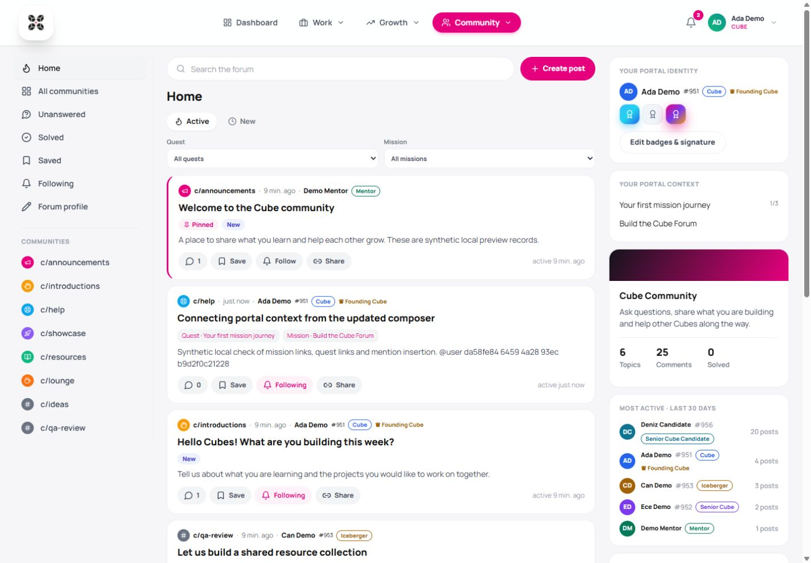

# Forum UI V4 — updated real-api design with portal integration

This branch starts at `forum/real-api` commit `00473584f1e0f73b40911138404f99322d059dee`. It retains the English community feed, magenta palette, white cards, collapsible comments and whole-board statistics. The portal integration previously built in `ui-v3` is adapted to that layout. Work belongs only to `umrtkyrk/iceberg-x-os:codex/ui-v4`; no upstream change, merge or deployment is included.

## Completed gaps

- Public author identity comes from portal records: real avatar, Cube number, profile link, progression, candidacy and Founding Cube. Account role controls moderation; Senior Cubes and Icebergers do not gain staff permissions.
- Forum profile settings persist an ordered selection of up to three **earned** badges and a plain-text signature of at most 140 characters. The server rejects foreign, duplicate and fourth badges. Revoked badges disappear. Every post shows its author's own showcase and signature.
- Quest/mission context uses actual accessible portal records. Cubes can attach assigned quests and missions they contribute to. Staff see a catalogue rather than fabricated personal progress. Context links and filters do not complete quests or issue rewards.
- Active Cubes and staff can post. Alumni, Former Cubes and Cube accounts without profiles have read-only posting access, enforced on the server. They retain their own preferences, bookmarks, follows and the ability to withdraw their posts.
- Admins can create/edit communities and remove only empty communities without topic history. Announcements remain staff-only. Mentors/Admins can move, pin, lock and remove topics and review reports. Nobody can rewrite another author's words.
- Category cards include topic/reply counts and latest activity. New/unread indicators use persisted read markers. Reply activity, pinning and moves do not falsely mark the original topic as edited.
- Name search inserts stable `@cube-018` or staff `@user-<UUID>` handles. Reply recipients combine the author, followers and mentions, excluding self and offboarded accounts and deduplicating overlaps. Code fences (backticks or tildes), inline code and quoted lines do not generate mentions. At most ten distinct handles are processed; edits do not resend notifications.
- The existing portal bell and notification history link to exact forum replies. The backend resolves the target's current page. Both English `topic`/`reply` URLs and legacy `konu`/`yanit` URLs work. Manual pagination clears the notification target so it cannot force navigation back to the original reply.
- Sidebar statistics and reports use the same public author projection as posts. Raw profile relations, private contact fields and earned-badge inventories are not included in their author responses. The Unanswered feed and sidebar both exclude locked/answered topics across communities. Sidebar loading/failure states do not masquerade as zero activity.
- All forum styles, including Markdown rules, are scoped under `.cube-forum`. The portal's other Markdown pages are unaffected. Profile/context tools remain accessible on mobile below the feed.

## Local setup and migrations

Use the portal's normal local PostgreSQL/authentication setup. Set `DATABASE_URL` and `DIRECT_URL` (the same local connection works for both), `JWT_SECRET`, and `FORUM_ENABLED=true` in the backend. Set `VITE_CUBE_FORUM_ENABLED=true` in the frontend, then:

```sh
npm ci --prefix backend
npm ci --prefix frontend
cd backend
npx prisma generate
npx prisma migrate deploy
```

Start the normal backend/frontend dev scripts and open `/forum`. Both feature flags default to off. The latest real-api behavior is preserved: there is no local-storage demo fallback, and no sample topics/accounts are seeded by application code.

The additional migration `20261029120000_forum_portal_integration` is copied unchanged from `ui-v3`: three new tables (`ForumProfile`, `ForumTopicContext`, `ForumNotificationTarget`), their foreign keys/indexes and an insert-if-missing Ideas community. Existing category IDs, topic history and portal columns remain intact. Its historical Ideas label is retained; Admin can change it through community settings. It is safe to reuse this migration when moving between the two design branches against a migrated local database.

The English category-name migration already belongs to `0047358`; it is inherited unchanged. No existing migration was rewritten. The pre-existing portal Quest migration ordering problem is also unchanged. The database test constructs a portal baseline in a random disposable schema, then applies the forum migrations in order; it does not claim to verify the historical full migration chain.

## Validation

```sh
npm run build --prefix backend
npm test --prefix backend
npm run test:forum --prefix backend
npm run test:forum:flag --prefix backend
npm run check:forum --prefix frontend
npm run test:forum --prefix frontend
npm run build --prefix frontend
# DATABASE_URL must point to a disposable localhost database:
npm run test:forum:db --prefix backend
```

Verified on 2 November 2026 with separate local PostgreSQL and synthetic Cube/Admin/Alumni accounts: badge order/signature persistence across reload, fourth-badge prevention, topic creation with quest/mission links and a searched mention, topic movement to an Admin-created community, notification-to-reply focus, manual pagination, Alumni read-only UI and 390px/1440px layouts without page overflow. Database tests cover additive SQL, ownership, read-only posting policy, badge validation, context access without reward side effects, recipient deduplication, reply page resolution, stats/report privacy, unanswered consistency and soft/account deletion. Feature-off tests hide all forum routes without a database.

The inherited accepted-answer feature remains available even though it is outside the mission's minimum scope. No reactions, uploads, reputation, Radar/MVCubes score changes or email digests were added. The inherited write limiter remains in memory per process (20/minute); distributed limiting remains a separate concern. Frontend build retains the portal's existing large-bundle warning.

## Screenshots — synthetic local data



[Mobile](forum-ui-v4-mobile.jpg)
