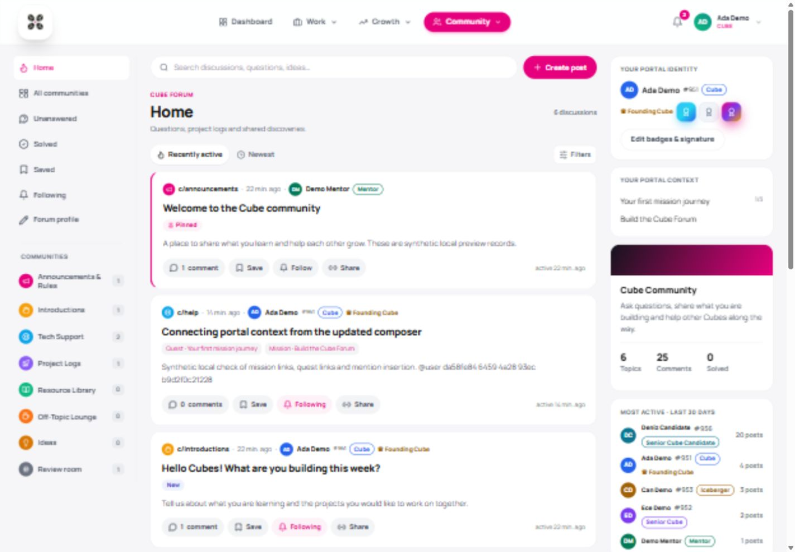

# Forum UI V5

Incremental polish on `codex/ui-v4` (`fafa067`), saved only in the fork's `codex/ui-v5` branch. The real-api community feed and portal palette remain the foundation. No upstream operation or deployment is included.

## Reading and navigation

- Mobile navigation uses two labelled selectors so profile settings, saved/followed discussions and all communities remain reachable without horizontal menu scrolling. Discussion/filtered states have their own selected label so Home can always be chosen.
- Desktop communities show descriptive names, icons and topic counts. Selected navigation and sort controls expose their state to assistive technology.
- Cards have clearer titles, spacing and author identity. Secondary text has stronger contrast. Real topic links support keyboard use and opening another tab; comment links have descriptive accessible names.
- The scoped button reset has zero specificity, preserving the portal Markdown editor's toolbar padding. Visible focus rings remain inside the forum. Loading placeholders reserve space without animation.

## Search and composition

- Search retains the current category, quest, mission and feed context. Filter changes reset pagination and remove stale topic/notification targets. Active filters can be removed separately or cleared together. Searching from profile/moderation screens opens discussion results; searching inside a thread uses its community.
- Optional quest/mission filters sit behind a Filters button. Empty results provide clear-filter and new-discussion actions. A new discussion's optional portal context is grouped separately from its title/body.
- Profile settings preview the chosen earned-badge order and signature before saving. Mention search now shows loading/no-match/error states, clears stale matches and identifies staff without displaying UUIDs in the search results.
- Topic composition focuses the title. Background loads respect focus in search/selection fields. The Share action offers a selectable URL when clipboard access is unavailable.

## Correctness fixes

- Solved filtering intersects the requested category instead of silently replacing it with Help. Solved statistics count Help topics only.
- Moving a topic outside Help clears its accepted-answer marker and preserves every reply. Pin/lock changes in Help preserve the selected answer.
- Thread pagination clamps to the remaining page count after moderation removes the final reply on a page. Empty threads return page one.

## Validation and setup

Setup, flags, permissions and migrations are unchanged from [UI V4](forum-ui-v4.md). This change adds no migration, dependency, production fixture or schema alteration.

Verified: backend build, 14 forum unit/API tests, real PostgreSQL integration regressions, frontend build and 10 frontend regressions for URL/filter state and CSS isolation. Browser checks with synthetic local data cover contextual search and clear-search, live profile preview, composer focus, mention no-results, Markdown formatting and 390px/1440px layouts without page overflow. The inherited portal bundle-size warning remains.

[Mobile](forum-ui-v5-mobile.jpg)
